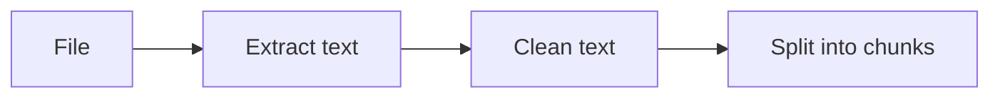

# Ingestion

How an uploaded file becomes clean text and then chunks. Code: `app/ingestion/` (`extract.py`, `chunking.py`).

## Extraction

### How each format is read

| Format | How it is read | Page numbers |
|---|---|---|
| PDF | `pypdf`, one page at a time | Yes |
| DOCX | `python-docx`; paragraphs, then tables as `cell \| cell` rows | No |
| TXT, Markdown | Decoded as UTF-8, byte-order mark removed | No |

**PDFs keep page numbers** so every chunk knows its pages and answers can cite "page 14".

**Word files have no page numbers.** Pages only exist once a word processor lays the document out, so any number we computed could be wrong. No number is better than a wrong one.

### Clear errors instead of empty documents

A file that cannot produce text is marked `failed` with a message the user can act on:

| Situation | The message says |
|---|---|
| Password-protected PDF | Remove the password and upload again |
| Damaged PDF or DOCX | The file could not be read |
| More pages than `MAX_PAGES` | The page count and the limit |
| No text at all (usually a scanned PDF) | It needs OCR, which is not supported yet |

### Cleaning the text

PDF text is messy. `normalize_text()` tidies it without changing its meaning:

- `informa-` / `tion` across a line break becomes `information`. Real hyphens like `well-known` stay.
- Repeated spaces become one, and lines are trimmed.
- At most one blank line is kept between paragraphs, because the chunker uses blank lines to find paragraphs.

## Chunking

### Why split documents at all

To answer a question, the relevant parts of the user's documents are sent to a language model. Sending whole documents does not work: they may not fit, they cost more, and answers get worse when the useful passage is buried in unrelated text.

So each document is split into small pieces called chunks. For each question, the few best-matching chunks are found and only those are sent.

### Sizes are counted in tokens

Models read and bill text in tokens (about three-quarters of a word). Chunks are measured with the same tokenizer family the models use (`o200k_base` via `tiktoken`), so a chunk's size in a prompt is known exactly.

### How text is packed

1. Break the text into the biggest natural pieces that fit in a chunk: paragraphs first, sentences if a paragraph is too long, and raw token windows only if a single sentence is too long.
2. Add pieces to the current chunk until the next one would not fit, then close it.
3. Start the next chunk with the last sentence or two of the previous one (the **overlap**).
4. Record the first and last page each chunk covers.

### Worked example

Limit: 30 words, overlap: about one sentence.

> ¹The Himalayan Observatory was founded in 1998. ²It sits at an altitude of 4,500 metres, which keeps it above most clouds. ³Its main telescope has a 2-metre mirror. ⁴That mirror was made in Germany and took three years to polish. ⁵Observations run from October to April. ⁶Monsoon rain makes the summer months too cloudy to use.

| Chunk | Sentences | Words |
|---|---|---|
| 0 | 1, 2, 3 | 28 |
| 1 | **3**, 4, 5 | 25 |
| 2 | **5**, 6 | 16 |

Adding sentence 4 to chunk 0 would make 40 words, so chunk 0 closes there. Bold sentences are repeated overlap.

### Why overlap matters

Sentence 4 alone says "That mirror was made in Germany", which does not say which mirror. Because of the overlap, chunk 1 also holds "Its main telescope has a 2-metre mirror", so the question *"Where was the telescope mirror made?"* finds the answer with its context.

## Choosing the chunk size

### The trade-off

| Too small (e.g. 50 tokens) | Too large (e.g. 2,000 tokens) |
|---|---|
| Loses context ("that mirror", but which?) | Mixes topics, so it matches no single question well |
| The model gets scattered fragments | Irrelevant text fills the prompt, raising cost |
| Many more chunks to store and search | Fewer, blunter search results |

### Why 400 tokens to start

Useful sizes are usually between about 200 and 800 tokens. 400 sits in the middle and is well under the embedding model's input limit. The 60-token overlap is about one or two sentences.

### Measured, not guessed

400 is an educated default, not a final answer:

1. Start with the default.
2. Run the evaluation suite with several sizes, for example 200, 400 and 800.
3. Compare retrieval hit rate, answer quality, cost and speed, and keep the best.
4. Run it again whenever something changes: the models, the prompt, or the kind of documents users upload.

Because sizes are settings, trying a new one is a one-line change.

### Short and long documents

Chunk size does not depend on document length. A chunk holds one idea, and an idea is about the same size in a short note or a long manual. Only the number of chunks changes:

| Document | About | Chunks at 400 / 60 |
|---|---|---|
| Two paragraphs | 200 tokens | 1 |
| 10-page report | 5,000 tokens | 15 |
| 1,000-page manual | 500,000 tokens | 1,500 |

Long documents are handled by other means: a fast search index ([Embeddings](embeddings.md)), background processing ([Worker](worker.md)), and the page and size limits.

The *kind* of document matters more than its length. Short FAQ entries may suit smaller chunks; long contracts may suit larger ones. Fancier strategies, such as section summaries, are left out until evaluation shows they are needed.

## Settings

| Variable | Default | Meaning |
|---|---|---|
| `MAX_PAGES` | 1000 | Largest PDF accepted |
| `MAX_UPLOAD_MB` | 20 | Largest upload |
| `CHUNK_MAX_TOKENS` | 400 | Largest chunk |
| `CHUNK_OVERLAP_TOKENS` | 60 | Tokens repeated from the previous chunk; must be smaller than the maximum |
| `TOKENIZER_ENCODING` | `o200k_base` | Tokenizer used to count tokens |
