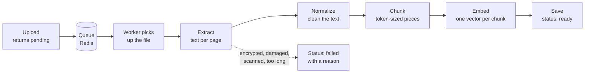

# How documents are ingested

This page explains what happens to a file after it is uploaded, and why each step works the way it does. The code lives in `app/ingestion/` (pure text processing), `app/embeddings/` (turning text into vectors), `app/services/ingestion.py` (orchestration and storage) and `app/worker/` (background processing).

## Why documents are split into chunks

A question is answered by sending the relevant parts of the user's documents to a language model. Sending whole documents does not work: a long PDF may not fit in the model's context, it is expensive, and answer quality drops when the relevant passage is buried in unrelated text.

Instead, each document is split into small pieces called chunks. When a question comes in, the system finds the few chunks that best match it and sends only those. Good chunks are therefore the foundation of good answers.

## 1. Extract

`extract_text()` turns the uploaded bytes into plain text.

| Format | How it is read | Page numbers |
|---|---|---|
| PDF | `pypdf`, one page at a time | Yes, 1, 2, 3, ... |
| DOCX | `python-docx`; paragraphs, then tables as `cell \| cell` rows | No (see below) |
| TXT, Markdown | Decoded as UTF-8, with any byte-order mark removed | No |

**Page numbers are kept for PDFs** so every chunk knows which pages it came from, and answers can cite "page 14". Word documents only have pages once they are rendered by a word processor, so any number we computed would not match what the user sees; they are stored without page numbers rather than with wrong ones.

**Problems are reported, not hidden.** A file that cannot produce text is marked `failed` with a message the user can act on:

| Situation | Message tells the user |
|---|---|
| Password-protected PDF | Remove the password and upload again |
| Damaged PDF or DOCX | The file could not be read |
| More pages than `MAX_PAGES` | The page count and the limit |
| No text at all (usually a scanned PDF) | It needs OCR, which is not supported yet |

## 2. Normalize

Text pulled from PDFs is messy. `normalize_text()` cleans it without changing its meaning:

- Words split across lines are rejoined: `informa-` / `tion` becomes `information`. Real hyphens such as `well-known` are left alone.
- Runs of spaces and tabs collapse to one space, and each line is trimmed.
- At most one blank line is kept between paragraphs. Blank lines matter because the chunker uses them to find paragraph boundaries.

## 3. Chunk

### Sizes are measured in tokens

Models read and bill text in tokens (roughly three-quarters of an English word), not characters or words. Chunks are measured with the same tokenizer family the models use (`o200k_base` via `tiktoken`), so the size of a chunk inside a prompt is known exactly.

### How text is packed into chunks

1. Text is broken into the largest natural pieces that fit in one chunk: whole paragraphs first; a paragraph that is too long is broken into sentences; a single sentence that is still too long (rare, for example a huge table row) is cut into token windows as a last resort.
2. Pieces are added to the current chunk one by one. When the next piece would push the chunk over the limit, the chunk is closed.
3. The next chunk starts by repeating the last sentence or two of the previous one (the **overlap**), then continues with new text.
4. Each chunk records the first and last page it covers.

### Worked example

With a limit of 30 words and an overlap of about one sentence, this text:

> ¹The Himalayan Observatory was founded in 1998. ²It sits at an altitude of 4,500 metres, which keeps it above most clouds. ³Its main telescope has a 2-metre mirror. ⁴That mirror was made in Germany and took three years to polish. ⁵Observations run from October to April. ⁶Monsoon rain makes the summer months too cloudy to use.

becomes three chunks:

| Chunk | Sentences | Words |
|---|---|---|
| 0 | 1, 2, 3 | 28 |
| 1 | **3**, 4, 5 | 25 |
| 2 | **5**, 6 | 16 |

Sentence 4 would have taken chunk 0 to 40 words, so chunk 0 was closed. Bold sentences are repeated from the previous chunk.

### Why overlap matters

Sentence 4 says "That mirror was made in Germany". On its own, "that mirror" could refer to anything. For the question *"Where was the telescope mirror made?"*, chunk 1 still contains *"Its main telescope has a 2-metre mirror. That mirror was made in Germany"*, so the answer and its context are found together. Overlap stops an idea that spans two sentences from being cut in half.

## 4. Embed

Search must match a question to chunks by **meaning**, not by exact words: "When was it built?" should find "The observatory was founded in 1998" even though they share no important word. An embedding model turns each chunk into a list of 1,536 numbers (a vector) so that texts with similar meaning get similar vectors. At question time the question is embedded the same way, and the closest chunk vectors are the most relevant chunks.

- **Model.** OpenAI `text-embedding-3-small` by default. Why this model, and when another would be better, will be documented in a model selection write-up backed by evaluation runs.
- **Batching.** Chunks are sent in batches (`EMBEDDING_BATCH_SIZE`, default 128) rather than one request each, which is far faster. The settings refuse a batch size that could exceed the provider's per-request token cap.
- **Stored with the chunk.** Each vector is saved in the chunk row (`vector(1536)` column via pgvector), next to its text and page numbers, so one query returns everything a citation needs.
- **Vectors know their model.** The document records which model produced its vectors. Vectors from different models are not comparable, so a model change means processing documents again.
- **Fast search.** An HNSW index on the vectors finds the closest chunks without comparing the question against every chunk, so search stays fast with hundreds of thousands of chunks. Cosine distance is used, which compares direction (meaning) rather than length.
- **Offline mode.** `EMBEDDING_PROVIDER=hashing` produces vectors from the words themselves, with no API key. It is used by the test suite and for development without network access. It does not understand meaning ("car" and "automobile" are unrelated to it), so it is never used to judge quality.

## Background processing

Processing a large PDF can take a while, and calling the embedding service adds network time. Doing that inside the upload request would leave the user waiting, tie up a web server, and fail the whole upload on any hiccup. So the work is split:

1. The upload endpoint stores the file, records the document as `pending`, puts its ID on a queue (Redis), and responds immediately.
2. A separate worker process (Celery) takes the ID from the queue and runs the steps above.
3. The client polls `GET /documents/{id}` until the status is `ready` or `failed`.

The API and workers scale independently: more uploads need more API instances, a backlog of documents needs more workers.

| What goes wrong | What happens |
|---|---|
| The file is unusable (scanned, password, damaged) | Marked `failed` at once with a reason; retrying would not help |
| The embedding service times out, rate-limits or is down | Back to `pending`, retried after 30 s, 1 min, 2 min, ... up to `INGESTION_MAX_RETRIES`; marked `failed` only after the last attempt |
| The embedding service rejects the request (bad key) | Marked `failed`; this needs a configuration fix, not a retry |
| A worker crashes mid-document | The task was not acknowledged, so the queue hands it to another worker. Safe because processing is idempotent |
| The queue is down during an upload | The upload still succeeds and the document stays `pending` |

Any document can be queued again with `POST /documents/{id}/process`, for example after a failure or after changing the embedding model.

## Choosing the chunk size

The defaults are 400 tokens per chunk with 60 tokens of overlap (`CHUNK_MAX_TOKENS`, `CHUNK_OVERLAP_TOKENS`).

| Chunks too small (e.g. 50 tokens) | Chunks too large (e.g. 2,000 tokens) |
|---|---|
| A chunk holds a sentence or two and loses its context | A chunk mixes several topics, so its embedding matches no single question well |
| The model receives scattered fragments | Every retrieved chunk carries irrelevant text into the prompt, raising cost and diluting the answer |
| Many more chunks to store and search | Fewer, blunter search results |

Common practice puts useful sizes between roughly 200 and 800 tokens, and 400 sits in the middle of that range, well below the input limit of embedding models. The overlap of 60 tokens is about one or two sentences: enough to carry context across a boundary without storing large amounts of text twice.

**These values are a starting point, not a final answer.** The right size depends on the documents and the models, so it is decided by measurement:

1. Start with the defaults above.
2. Run the evaluation suite (same documents, same questions) with several sizes, for example 200, 400 and 800 tokens.
3. Compare retrieval hit rate, answer correctness, faithfulness, cost and latency, and keep the best trade-off.
4. Re-run the evaluation whenever something that affects it changes: the embedding model, the chat model, the prompt, or the kind of documents users upload.

Because the sizes are settings rather than constants in code, trying a new value is a one-line configuration change.

## Short and long documents

The chunk size does not depend on document length. It is sized to hold one idea, which is roughly the same size in a two-page note or a thousand-page manual. Only the number of chunks changes:

| Document | Approximate size | Chunks at 400 / 60 |
|---|---|---|
| A couple of paragraphs | 200 tokens | 1 |
| 10-page report | 5,000 tokens | about 15 |
| 1,000-page manual | 500,000 tokens | about 1,500 |

Long documents raise other concerns, each handled separately:

- **Search speed.** With many documents there can be tens of thousands of chunks. An approximate nearest-neighbour index (HNSW in pgvector) finds the closest chunks without scanning all of them.
- **Processing time.** Large files take time to extract and embed, so processing runs in a background worker: the upload returns immediately with status `pending` and the document becomes `ready` when done.
- **Limits.** `MAX_PAGES` and `MAX_UPLOAD_MB` stop a single file from overloading the system.
- **Cost.** Each chunk is embedded once, so embedding cost grows linearly with document length. Overlap adds a little on top, since overlapping text is embedded twice. The evaluation reports will record actual cost per document.

The *type* of document often matters more than its length: short, independent FAQ entries may suit smaller chunks, while contracts with long, cross-referencing clauses may suit larger ones. If users mainly upload one kind of document, the evaluation set should reflect it.

More advanced strategies exist for very long documents, such as storing section summaries alongside detailed chunks. They are deliberately left out until evaluation shows the simple approach falling short.

## Reliability

- **Idempotent.** Processing a document again replaces its chunks rather than appending, so retries never create duplicates.
- **Safe under concurrency.** A worker claims a document with `SELECT ... FOR UPDATE SKIP LOCKED`, so two workers never process the same document at once.
- **Non-blocking.** CPU-heavy parsing and tokenizing run in a worker thread so the async event loop stays responsive.
- **Fails loudly.** Unexpected errors mark the document `failed` with a generic message and are re-raised so they are logged and can be retried.

## Settings

| Variable | Default | Meaning |
|---|---|---|
| `CHUNK_MAX_TOKENS` | 400 | Largest chunk, in tokens |
| `CHUNK_OVERLAP_TOKENS` | 60 | Tokens repeated from the previous chunk; must be smaller than the maximum |
| `TOKENIZER_ENCODING` | `o200k_base` | `tiktoken` encoding used to count tokens |
| `MAX_PAGES` | 1000 | Largest PDF accepted, in pages |
| `MAX_UPLOAD_MB` | 20 | Largest upload, in megabytes |
| `EMBEDDING_PROVIDER` | `openai` | `openai`, or `hashing` for offline development and tests |
| `EMBEDDING_MODEL` | `text-embedding-3-small` | Embedding model name |
| `EMBEDDING_BATCH_SIZE` | 128 | Chunks per embedding request |
| `OPENAI_API_KEY` | none | Required when the provider is `openai` |
| `REDIS_URL` | `redis://localhost:6379/0` | Queue used to hand documents to workers |
| `INGESTION_MAX_RETRIES` | 4 | Retries after an embedding-service outage before giving up |
