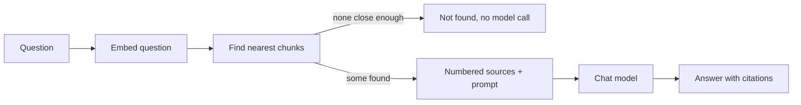

# Retrieval and answers

How a question becomes a cited answer. Code: `app/services/questions.py`, `app/repositories/chunks.py` (search) and `app/llm/` (chat model and prompt).

## The flow

1. **Embed the question** with the same model the documents were embedded with.
2. **Search** the user's own chunks for the nearest vectors, using the HNSW index.
3. **Drop chunks that are not close enough.** The nearest chunk is not always relevant: for a question about cooking, the closest passage in a physics paper is still unrelated.
4. **If nothing is left, say so** without calling the chat model. That avoids cost and avoids inviting a made-up answer.
5. **Otherwise number the chunks** as sources [1], [2], ... with the file name and pages, and ask the chat model to answer only from them, citing each claim.
6. **Check the citations.** Numbers that do not match a real source are removed, and duplicates are collapsed.

`POST /api/v1/questions` returns the answer, whether it could be answered, every retrieved source with `cited` marking the ones the answer used, the model, token usage and latency.

## What is searched

- **Only the user's own documents.** The owner filter is part of the query itself, so another user's chunks can never reach the model.
- **Only documents that are `ready`.** A document being processed again is left out until it finishes.
- **Only vectors from the current embedding model.** Vectors from different models cannot be compared, so documents embedded with an older model are skipped until processed again.
- **Optionally, only chosen documents** (`document_ids`), for "ask about this file".

## Keeping answers honest

- **Answer only from the sources.** The prompt forbids outside knowledge, and asks the model to say when the documents do not cover the question, or only partly do.
- **Structured output.** The model must return JSON with `answerable`, `answer` and `citations`, so citations never have to be guessed out of free text.
- **Documents are data, not instructions.** Sources are wrapped in `<source>` tags and the prompt says text inside them is never an instruction. A document containing `</source>` cannot close its own block early. This reduces, but cannot fully remove, the risk of a document that tries to steer the model (prompt injection).
- **The question is not logged.** Logs record counts, tokens and latency, not the user's content.

## Why these numbers

### 5 chunks per question (`RETRIEVAL_TOP_K`)

| Fewer (1 to 2) | More (10 to 20) |
|---|---|
| Misses answers spread across several passages | Catches more, but adds loosely related text |
| Cheaper prompt | Larger prompt: more cost, slower, and the model can be distracted |

Five chunks of up to 400 tokens is about 2,000 tokens of context: enough for answers that span a few passages, small enough to stay cheap and focused. The evaluation suite will compare 3, 5 and 8 using retrieval hit rate and answer correctness. Callers can also set `top_k` per question.

### Distance cut-off of 0.8 (`RETRIEVAL_MAX_DISTANCE`)

Cosine distance runs from 0 (same direction, same meaning) to 2 (opposite). Unrelated text usually lands near 1. A cut-off of 0.8 removes clearly unrelated chunks while keeping anything plausibly relevant.

| Stricter (e.g. 0.5) | Looser (e.g. 1.0) |
|---|---|
| Fewer irrelevant sources | Rarely misses a relevant chunk |
| Risks answering "not found" when the answer exists | The model sees unrelated text more often |

The right value depends on the embedding model, so it is **the setting most in need of evaluation**: the suite will measure how often relevant chunks fall above the line and irrelevant ones below it, and pick the value that balances the two.

### `ef_search` of 100 (`RETRIEVAL_EF_SEARCH`)

HNSW is approximate: it examines a list of candidates rather than every vector. `ef_search` is the size of that list. pgvector's default is 40; 100 finds the true nearest chunks more reliably for a small cost in speed, which matters because a missed chunk means a missed answer. With pgvector 0.8 or later, an iterative scan also keeps searching when the owner filter removes candidates, so a user with a few documents among many still gets a full set of results.

### Chat model: `gpt-6-luna` (`CHAT_MODEL`)

OpenAI describes it as its most efficient model for focused, high-volume tasks. Answering from a handful of supplied passages is exactly that: the hard part (finding the passages) is done by retrieval, and the model mainly has to read, combine and cite. Larger models cost more per question and add latency without a clear gain for this task.

Like the other numbers here, this is a starting point. The evaluation suite will compare it with a larger model on answer correctness, faithfulness to the sources, latency and cost per question, and the full reasoning will be written up with those results. The model is a setting, so switching is a configuration change.

### 1,000 output tokens (`CHAT_MAX_OUTPUT_TOKENS`)

Roughly 700 words, far more than a concise cited answer needs. The cap protects against runaway cost. If an answer hits it, the request fails clearly rather than returning a half-finished sentence.

### 2,000-character questions (`QUESTION_MAX_CHARS`)

Long enough for a detailed question, short enough to stop someone pasting a whole document as a "question".

## Running without an API key

`CHAT_PROVIDER=extractive` replaces the chat model with one that quotes the best source. Tests and offline development use it, together with the hashing embedder. It does not reason or summarise, so it is never used to judge quality.

## Settings

| Variable | Default | Meaning |
|---|---|---|
| `CHAT_PROVIDER` | `openai` | `openai`, or `extractive` for tests and offline work |
| `CHAT_MODEL` | `gpt-6-luna` | Chat model name |
| `CHAT_MAX_OUTPUT_TOKENS` | 1000 | Longest answer the model may write |
| `RETRIEVAL_TOP_K` | 5 | Chunks retrieved per question |
| `RETRIEVAL_MAX_DISTANCE` | 0.8 | Chunks further than this are dropped |
| `RETRIEVAL_EF_SEARCH` | 100 | HNSW candidate list size |
| `QUESTION_MAX_CHARS` | 2000 | Longest question accepted |
